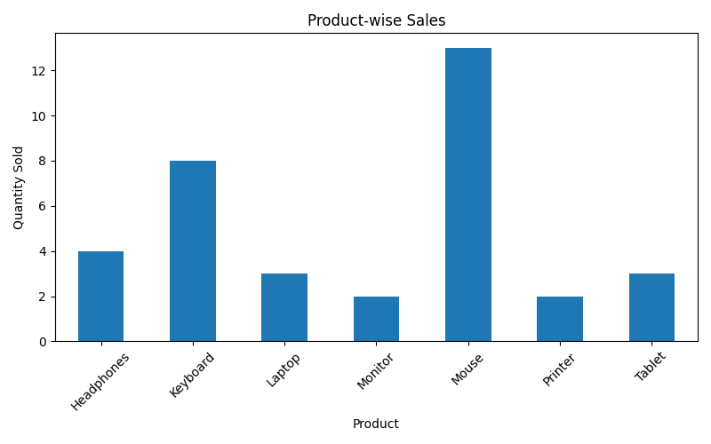

# Sales Data Analysis Using Python

## Project Overview

This project analyzes sales data using Python to identify sales trends, calculate total revenue, and understand product-wise sales performance.

## Technologies Used

* Python
* Pandas
* Matplotlib

## Features

* Calculates total sales revenue.
* Analyzes product-wise sales quantities.
* Identifies the best-selling product.
* Generates visualizations to understand sales performance.
* Exports analyzed data into CSV files.

## Project Structure

* `data/` – Contains the sales dataset.
* `output/` – Contains generated charts and analysis results.
* `main.py` – Main Python program.
* `requirements.txt` – Required Python libraries.

## How to Run

1. Clone this repository.

2. Install the required libraries:

   `pip install -r requirements.txt`

3. Run the program:

   `python main.py`

## Project Output
## Project Screenshot

The project generates sales analysis results and a product-wise sales visualization.

## Author

Almina R Navas
